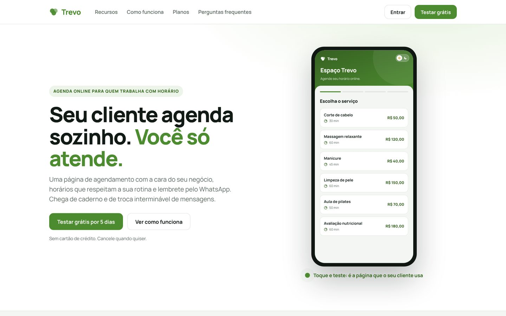
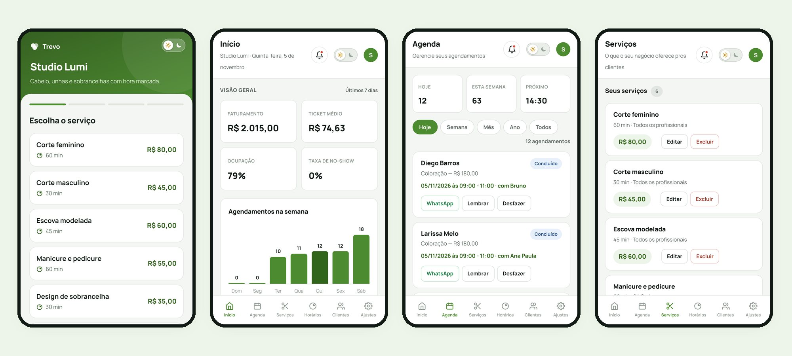
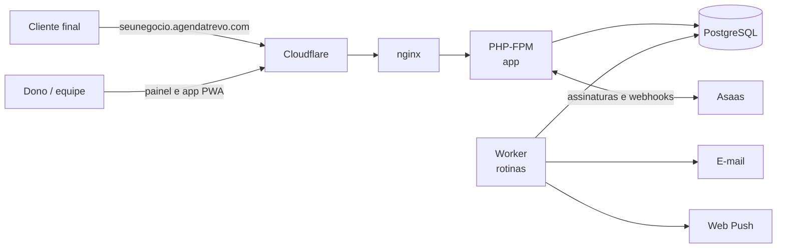
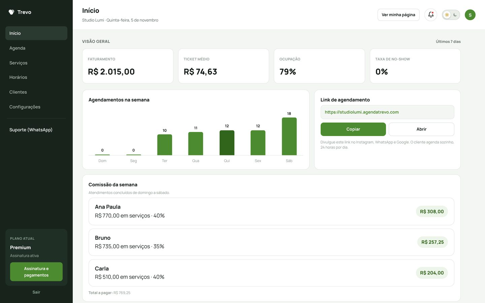
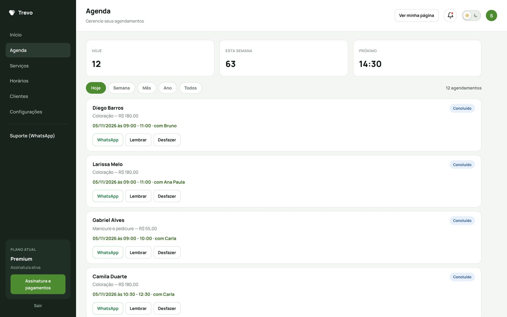
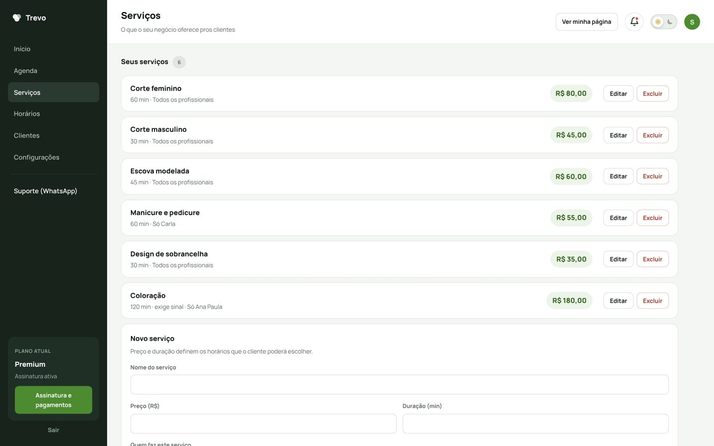
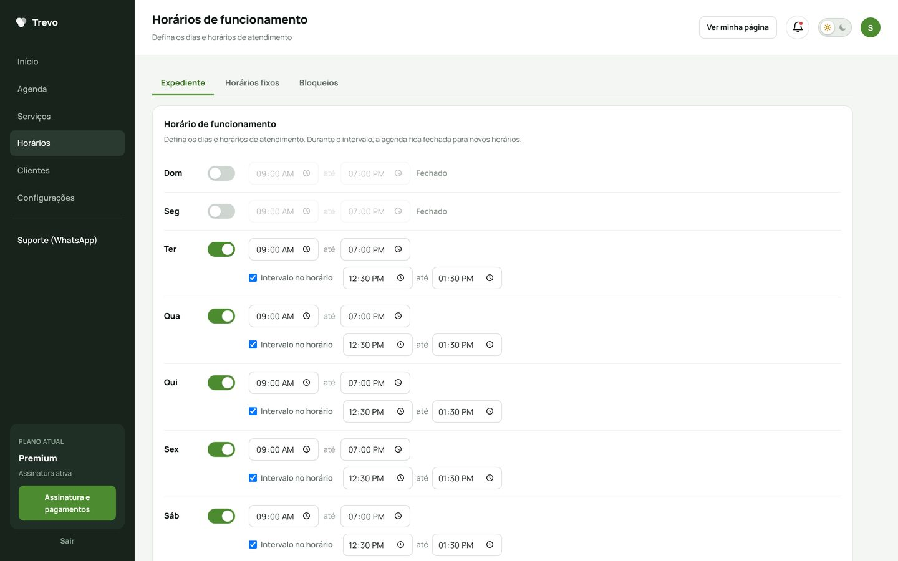
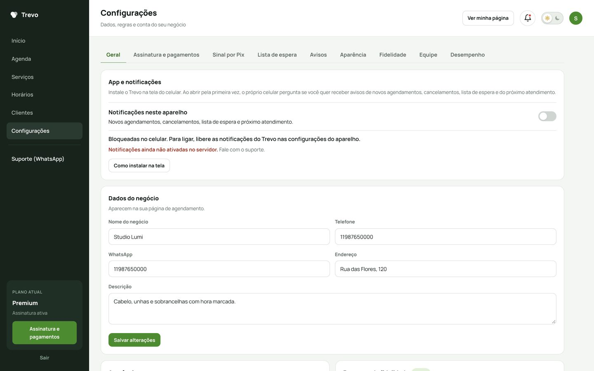
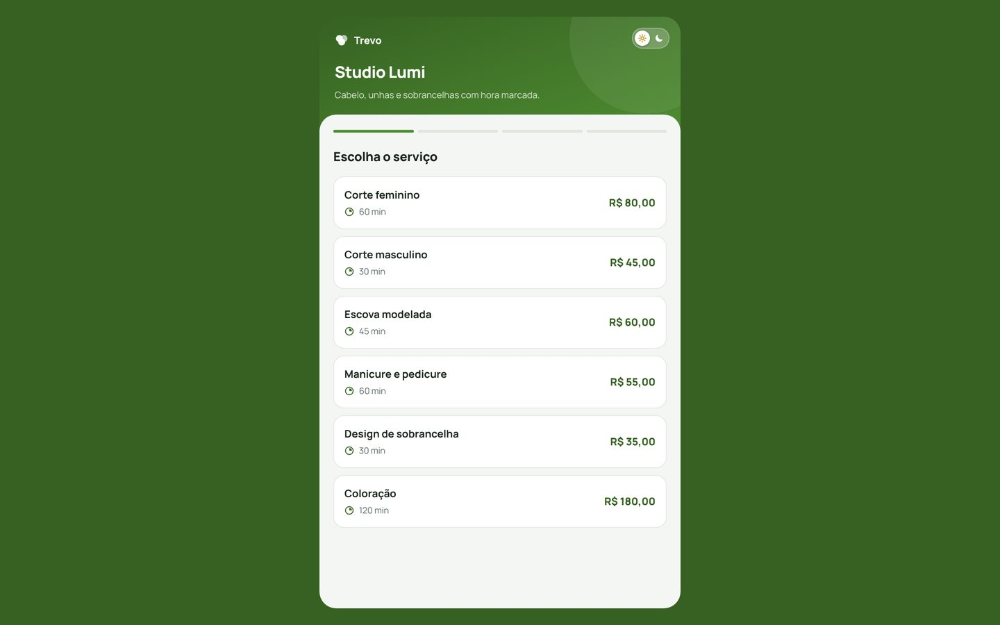
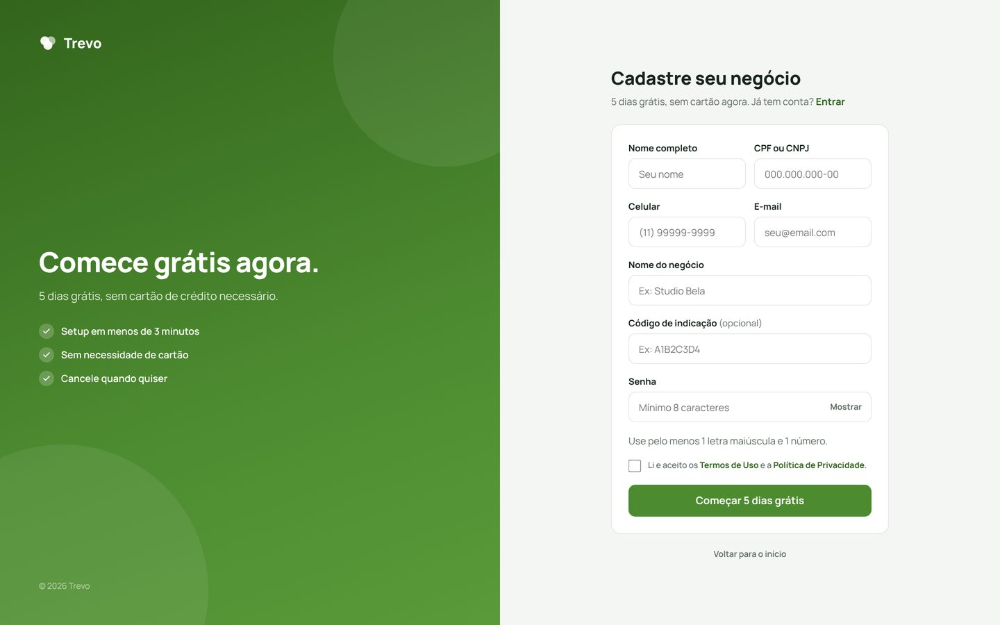

# Trevo — Agenda online para quem trabalha com horário

**SaaS de agendamento multi-tenant em produção, com clientes reais.**
Cada negócio ganha uma página própria de agendamento, um painel completo e um app para o celular.

[Site](https://agendatrevo.com) · [Funcionalidades](#funcionalidades) · [Arquitetura](#arquitetura) · [Telas](#telas)

 

---

## Sobre

O **Trevo** substitui o caderno e a troca interminável de mensagens. Barbearias, salões, estúdios e outros prestadores de serviço divulgam um link (ex.: `seunegocio.agendatrevo.com`) e o cliente agenda sozinho, 24 horas por dia, respeitando os horários, os profissionais e as regras de cada negócio.

O dono acompanha tudo por um painel no computador ou no celular: agenda do dia, faturamento, ocupação, comissões da equipe e avisos de novos agendamentos.

## Funcionalidades

**Para o cliente final**
- Página de agendamento com a cara do negócio, em subdomínio próprio
- Escolha de serviço, profissional, dia e horário livre, em poucos toques
- Cancelamento e remarcação pelo link recebido, com aviso ao profissional pelo WhatsApp
- Lista de espera para horários concorridos
- Sinal antecipado por Pix (opcional por negócio)

**Para o negócio**
- Painel com faturamento, ticket médio, ocupação e taxa de faltas
- Agenda com filtros (hoje, semana, mês), status e lembrete pelo WhatsApp
- Serviços com duração e preço, profissionais e comissões por pessoa
- Horário de funcionamento com intervalo, horários fixos (recorrentes) e bloqueios
- Histórico de clientes, visitas e faltas; programa de fidelidade
- Notificações push e por e-mail, com preferências por tipo de aviso
- App instalável (PWA) com tema claro e escuro

**Plataforma**
- Multi-tenant: dados isolados por negócio em todas as consultas
- Planos e assinatura recorrente (Pix, boleto e cartão) com teste grátis
- Cobrança automática com lembretes antes e depois do vencimento
- Cadastro com e-mail ou conta Google, verificação de e-mail e recuperação de senha
- Modo manutenção e painel interno da equipe (DevStudio) para deploy, tarefas e auditoria

## Tecnologias

| Camada | Tecnologia |
| --- | --- |
| Back-end | PHP 8.4 (sem framework), PHP-FPM |
| Banco de dados | PostgreSQL, migrations versionadas em SQL |
| Front-end | HTML, CSS e JavaScript puros (sem build) |
| App | PWA com service worker e Web Push (VAPID) |
| Pagamentos | Asaas (assinaturas, Pix, boleto) via API e webhooks |
| E-mail | SendGrid / SMTP, com fila e reenvio automático |
| Infraestrutura | Docker Compose (app, worker, nginx), VPS Linux |
| Borda | Cloudflare (DNS, proxy, proteção DDoS) |
| Fluxo | GitHub com ambientes de teste (`develop`) e produção (`main`) |

## Arquitetura

- **Multi-tenant por subdomínio:** o negócio é identificado pelo endereço acessado e todas as consultas são filtradas pelo seu identificador.
- **Worker em segundo plano:** e-mails, lembretes, cobranças, sinais vencidos, horários fixos e retenção de dados (LGPD) rodam fora da requisição.
- **Dois ambientes:** cada mudança passa pelo servidor de teste antes de ir para a produção.

## Regras de negócio

- Disponibilidade calculada a partir do expediente, intervalos, bloqueios, duração do serviço e agenda de cada profissional
- Prevenção de conflitos e de agendamentos duplicados, inclusive em requisições simultâneas
- Antecedência mínima e máxima configuráveis por negócio
- Limites de serviços, profissionais e recursos conforme o plano contratado
- Troca de plano só vale depois do pagamento confirmado
- Fuso horário por negócio

## Segurança

- Senhas com hash, sessões protegidas e tokens de uso único para links sensíveis
- Proteção contra CSRF, limite de tentativas em login, cadastro e recuperação de senha
- Cabeçalhos de segurança (CSP e afins) e servidor acessível só pela Cloudflare
- Dados pessoais tratados conforme a LGPD, com exclusão e retenção automáticas

## Telas

| Painel — Início | Painel — Agenda |
| --- | --- |
|  |  |
| **Serviços** | **Horários** |
|  |  |
| **Configurações** | **Página de agendamento** |
|  |  |
| **Cadastro** | **Login** |
|  |  |

> As telas usam um negócio de demonstração (“Studio Lumi”) com dados fictícios.

## Sobre este repositório

Este é um repositório de **apresentação**. O código-fonte do Trevo é privado, por se tratar de um produto em uso por clientes reais.

Quer conhecer mais ou conversar sobre o projeto? Fale comigo pelo [GitHub](https://github.com/Santaanadev).

---

Desenvolvido por <a href="https://github.com/Santaanadev">Ian Santana</a>

